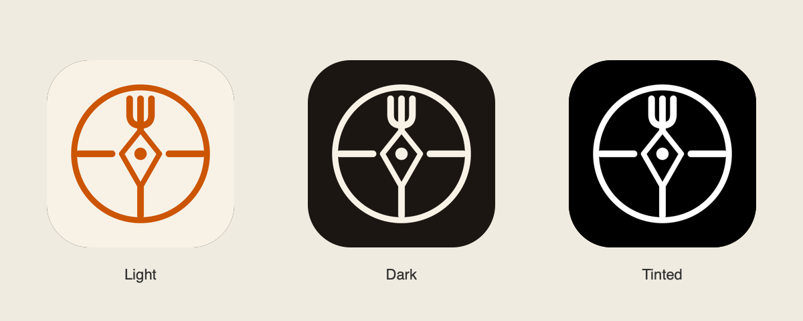

# Scout — Atlas identity

The compass-and-fork mark extends `ScoutCompass` from the approved Atlas mockup in `Scout/designs/Scout-handoff/scout/project/data.jsx`. The north needle is a three-tine fork; the inner diamond and cardinal rays retain the restaurant/discovery motif. The fork bowl and stroke weights are adapted for legibility at Home Screen sizes.



## Assets

- `ScoutCompass.svg`: portable vector mark, no text, fonts, or embedded raster images. Change `color` to recolor it.
- `../Scout/Assets.xcassets/ScoutCompass.imageset/ScoutCompass.pdf`: the same vector geometry as a SwiftUI template image. `ScoutBrandMark` uses it on sign-in, first-circle, and auth-loading screens.
- `../Scout/Assets.xcassets/AppIcon.appiconset/Scout-Light.png`: opaque 1024px sRGB paper/burnt-orange icon.
- `Scout-Dark.png` in that icon set: 1024px cream foreground with transparent background for the system's dark surface.
- `Scout-Tinted.png` in that icon set: opaque 1024px grayscale silhouette for system tinting. The preview shows its grayscale source, not an applied user tint.
- `Preview.png`: contact sheet; its rounded masks and dark backdrop are illustrative. Source iOS icons remain square and the OS applies its own mask.

The existing empty Mac icon slots are preserved; this delivers the iOS/iPadOS identity. It does not add Icon Composer layers or claim native layered Liquid Glass artwork.

## Palette and type

| Token | sRGB | Use |
|---|---|---|
| Paper | `#F7F1E6` | Light icon background, dark icon foreground |
| Burnt orange | `#CC5500` | Light icon glyph, app template mark, asset-catalog AccentColor |
| Ink | `#1B1612` | Existing editorial text; illustrative dark preview backdrop |

Keep the existing DM Serif Display wordmark and DM Sans UI typography. Use the compass alone for small icons; the app name already appears below the Home Screen icon. Keep the mark decorative next to the accessible Scout heading.

## Regenerate and verify

Run from the repository root on macOS with Xcode command-line tools:

```sh
swift Scripts/generate-brand-assets.swift
swift Tests/validate-brand-assets.swift
```

The generator's native Core Graphics geometry is the source of truth for the SVG, PDF, PNGs, and contact sheet. Edit it and regenerate the assets together. It uses explicit sRGB colors to avoid Device RGB conversion changing the palette. No network, API keys, image-generation service, or third-party graphics packages are used. PDF metadata may change on regeneration even when its geometry is unchanged.

After building, verify the compiled bundle too:

```sh
swift Tests/validate-brand-assets.swift /tmp/scout-derived/Build/Products/Debug-iphonesimulator/Scout.app
```

The checks cover icon appearance slots, dimensions, alpha rules, exact palette samples, grayscale tint input, vector template configuration, and the compiled app's icon declaration/renditions. Review the icon on a Simulator Home Screen and the sign-in mark at phone size. Physical-device icon customization, App Store validation, and display-specific color appearance remain release checks.
